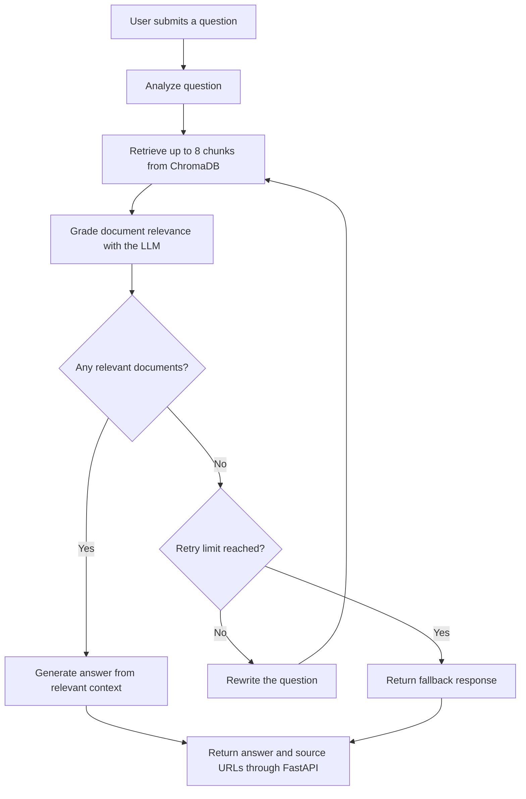

# RAG Tech Assistant

A documentation assistant built with Retrieval-Augmented Generation (RAG), LangGraph, ChromaDB, and Groq. It retrieves technical documentation, grades retrieved passages for relevance, rewrites queries when retrieval is insufficient, and generates answers grounded in the available sources.

## Overview

The goal of this project is to explore how an LLM-powered assistant can answer technical questions using indexed documentation rather than relying only on its pretrained knowledge.

### Key Features

- **Document ingestion:** Load technical documentation from web URLs and local Markdown files.
- **Semantic retrieval:** Search indexed document chunks using Hugging Face embeddings and ChromaDB.
- **Relevance grading:** Use an LLM to assess whether retrieved documents are relevant to the question.
- **Query rewriting:** Retry retrieval with a rewritten query when no documents pass the relevance check.
- **Grounded generation:** Generate answers using relevant retrieved context.
- **Source references:** Return source URLs alongside the answer.
- **REST API:** Expose the assistant through FastAPI.
- **Testing and evaluation:** Include API tests and a small retrieval evaluation script.

## Architecture

The system has three main stages:

1. **Ingestion:** Load documentation, split it into chunks, generate embeddings, and store them in ChromaDB.
2. **Question answering:** Receive a question, retrieve relevant chunks, grade relevance, optionally rewrite the query, and generate an answer.
3. **API response:** Return the answer and source URLs as JSON.

See [`docs/architecture.md`](docs/architecture.md) for the ingestion, decision-flow, and application architecture diagrams.

## Technology Stack

| Component | Technology |
|---|---|
| Language | Python |
| API | FastAPI |
| Workflow orchestration | LangGraph |
| RAG and document processing | LangChain |
| Vector database | ChromaDB |
| Embeddings | `sentence-transformers/all-MiniLM-L6-v2` |
| Language model | Groq API |
| Configuration | `python-dotenv` |
| Testing | pytest |

## Project Structure

```text
rag-tech-assistant/
├── app/
│   ├── graph/
│   │   ├── nodes.py
│   │   ├── state.py
│   │   └── workflow.py
│   ├── ingestion/
│   │   ├── embeddings.py
│   │   ├── loader.py
│   │   ├── pipeline.py
│   │   └── splitter.py
│   ├── config.py
│   ├── llm.py
│   └── main.py
├── data/
│   └── urls.txt
├── docs/
│   └── architecture.md
├── documents/
├── scripts/
│   ├── evaluate_retrieval.py
│   ├── run_graph_demo.py
│   └── check_groq_connection.py
├── tests/
│   └── test_api.py
├── .env.example
├── .gitignore
├── ingest.py
├── requirements.txt
├── requirements-dev.txt
└── README.md
```

Other helper scripts and configuration files are also included in the repository.

## Prerequisites

- Python 3.12 recommended for this project setup.
- A Groq API key.
- Internet access for downloading documentation, model files, and calling the Groq API.

## Installation

### 1. Clone the repository

```bash
git clone <YOUR_GITHUB_REPOSITORY_URL>
cd rag-tech-assistant
```

Replace `<YOUR_GITHUB_REPOSITORY_URL>` with your repository URL after publishing.

### 2. Create and activate a virtual environment

macOS or Linux:

```bash
python3.12 -m venv .venv
source .venv/bin/activate
```

Confirm the active Python interpreter:

```bash
python --version
```

### 3. Install dependencies

For development and testing:

```bash
python -m pip install -r requirements-dev.txt
```

### 4. Configure environment variables

Create a local environment file:

```bash
cp .env.example .env
```

Edit `.env` and replace the placeholder with your own Groq API key. Keep `.env` private; never commit it or share its contents.

The configuration uses:

- `GROQ_API_KEY` — your Groq API key.
- `MODEL_NAME` — the language model configured for the application.

## Prepare the Vector Database

Build the local ChromaDB collection:

```bash
python ingest.py
```

The ingestion pipeline loads the URLs in `data/urls.txt` and supported local Markdown documents in `documents/`, splits the content into chunks, and indexes it for semantic retrieval.

**Important:** Running ingestion rebuilds the indexed collection. Run it when you want to refresh or recreate the index, not for every question.

The generated `chroma_db/` directory is local and excluded from Git. A fresh clone must build its own index before querying the assistant.

## Run the API

Start the development server:

```bash
python -m uvicorn app.main:app --reload
```

Available endpoints:

| Endpoint | Purpose |
|---|---|
| `GET /` | Redirects to the interactive API documentation |
| `GET /health` | Basic application health check |
| `POST /query` | Submit a technical question |

Open the interactive API documentation at:

http://127.0.0.1:8000/docs

### Example API request

```bash
curl -X POST "http://127.0.0.1:8000/query" \
  -H "Content-Type: application/json" \
  -d '{"question":"What is Agentic RAG?"}'
```

The response contains the submitted question, generated answer, and source references. The exact answer depends on the indexed documents and the language model response.

Example response shape:

```json
{
  "question": "What is Agentic RAG?",
  "answer": "Answer based on the retrieved documentation, with numbered citations.",
  "sources": ["source URL"]
}
```

The example illustrates the response structure; the actual answer and sources will vary.

## How the Workflow Works

1. Analyze the user's question.
2. Retrieve up to eight document chunks from ChromaDB.
3. Grade the retrieved documents for relevance using the language model.
4. If no documents pass the relevance check, rewrite the question and retry retrieval, up to the configured retry limit.
5. Generate an answer from the relevant context, or return a fallback if no relevant documents are found.
6. Return the answer and source URLs through the API.

### Workflow Diagram



The workflow is implemented in `app/graph/workflow.py`, with the individual processing steps in `app/graph/nodes.py`.

## Testing

Run the API test suite:

```bash
python -m pytest -q
```

Check installed dependency consistency:

```bash
python -m pip check
```

The API tests cover the root redirect, health endpoint, successful query response, invalid questions, maximum question length, and generic error handling.

## Retrieval Evaluation

Run the retrieval evaluation script:

```bash
python -m scripts.evaluate_retrieval
```

The current evaluation uses a small, manually selected set of questions and expected source documents. The recorded baseline was:

- Hit Rate@4: 100%
- Mean Reciprocal Rank (MRR): 0.929
- Test questions: 7

These results describe retrieval performance on that limited test set. They do not establish general performance across all questions or prove that generated answers are factually correct. A larger evaluation set and separate answer-quality checks would be needed for stronger conclusions.

## Security and Limitations

- API keys belong in `.env`, not in source code or Git.
- The local virtual environment and generated ChromaDB database are excluded from version control.
- The current API is a development implementation and has not been presented here as a production-hardened service.
- Answer quality depends on document coverage, retrieval quality, relevance grading, and language model behavior.
- Source references help users inspect the supporting documentation, but citations should still be checked for correctness.
- The retrieval evaluation is small and should be expanded before drawing broad conclusions.

## Future Improvements

- Add a simple user interface.
- Deploy the API to a hosting platform.
- Expand automated tests for retrieval, grading, query rewriting, retries, and citation correctness.
- Build a larger evaluation dataset and measure answer faithfulness.
- Add continuous integration to run tests automatically on GitHub.
- Improve monitoring, request limits, and production error handling.

## Project Status

This is an applied AI engineering project exploring a documentation-grounded assistant using RAG and a graph-based workflow. It is a practical implementation and evaluation project, not a claim of a novel retrieval algorithm.
