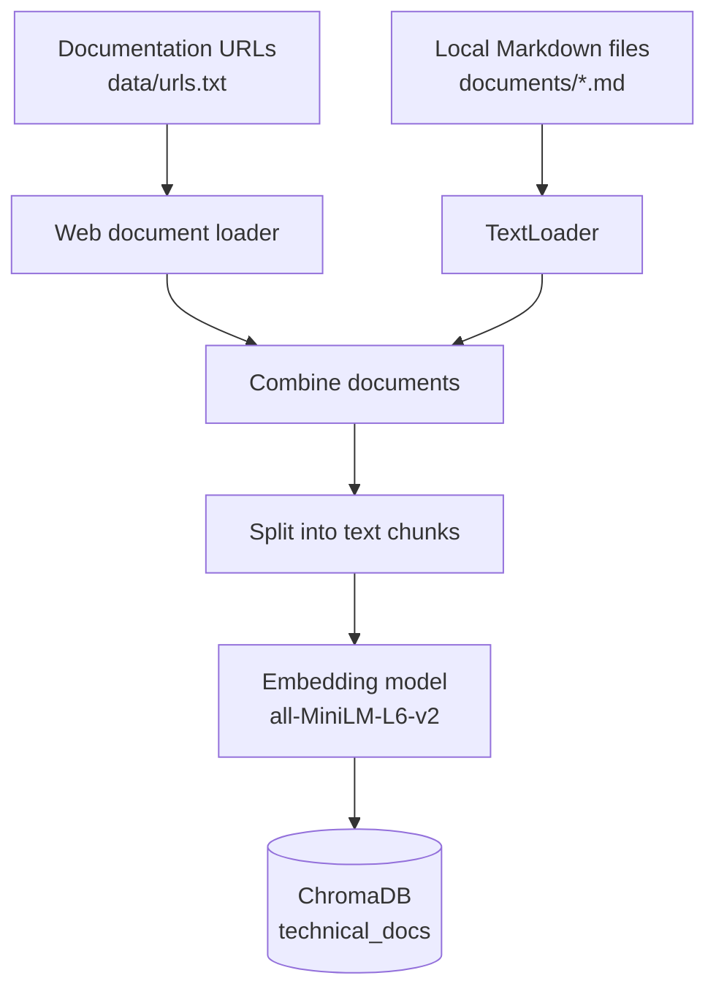
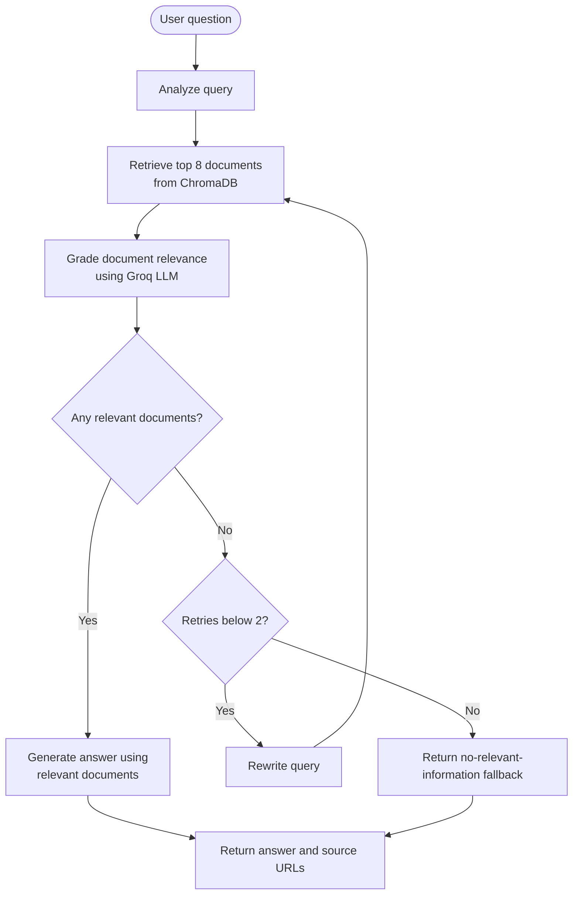
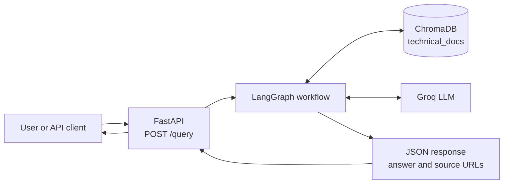

# RAG Tech Assistant — Architecture

This document explains how the RAG Tech Assistant collects technical
documentation, retrieves relevant information, and generates answers.

## 1. Document Ingestion Workflow

This workflow prepares documents for retrieval. Run `python ingest.py`
when you want to rebuild the local vector database.

## 2. Agentic RAG Workflow

This is the main question-answering workflow implemented with LangGraph.

**How to explain it:**

1. The user submits a technical question.
2. The workflow analyzes the question and retrieves up to eight document chunks.
3. The language model grades the retrieved chunks for relevance.
4. If no chunks pass the relevance check, the workflow rewrites the question and retries, up to two times.
5. If relevant chunks are found, the model generates an answer grounded in those chunks and includes numbered citations.
6. The API returns the answer and source URLs. If no relevant chunks are found after the retries, it returns a fallback message.

## 3. Application Runtime Architecture

This diagram shows how the main application components work together.

The workflow uses ChromaDB to retrieve documentation and the Groq language model to grade documents, rewrite questions when needed, and generate answers.

## 4. Main Project Files

| File or folder | Purpose |
|---|---|
| `app/main.py` | FastAPI endpoints |
| `app/graph/state.py` | State shared across workflow nodes |
| `app/graph/nodes.py` | Retrieval, grading, rewriting, and answer generation |
| `app/graph/workflow.py` | Connects the LangGraph nodes and defines routing |
| `app/ingestion/` | Loads, splits, and embeds documents |
| `data/urls.txt` | Web documentation sources |
| `documents/` | Optional local Markdown documentation |
| `ingest.py` | Builds the vector database |
| `scripts/evaluate_retrieval.py` | Evaluates retrieval against a small set of expected sources |
| `tests/test_api.py` | API tests |
| `chroma_db/` | Local generated vector database; not committed to Git |

## 5. Important Notes

- The vector database must be built before querying the application.
- Running `python ingest.py` rebuilds the indexed collection; use it deliberately.
- Numbered citations refer to sources included in the generated answer context.
- Retrieval evaluation measures source retrieval on the selected test questions. It does not, by itself, prove that every generated answer is correct.
